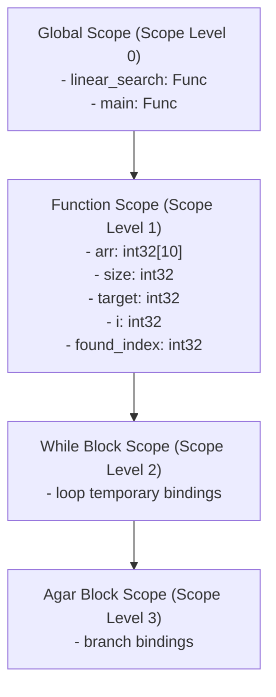
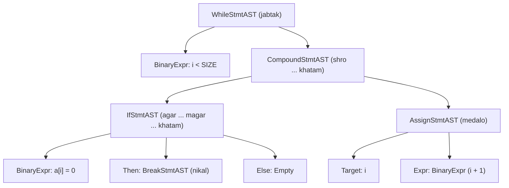
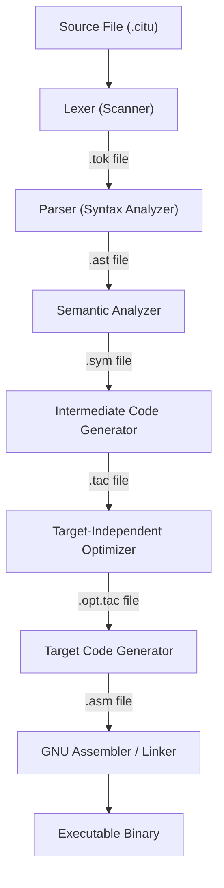

# Citu Language Specification & Compiler Design Document
**Course:** CS-310 / CS-410 Compiler Construction  
**Institution:** Information Technology University (ITU) of the Punjab, Lahore  
**Instructor:** Dr. Umar Suleman (`umarsuleman@gmail.com`)  
**Teaching Assistant:** `mscs24052@itu.edu.pk`  
**Student Name:** Mobeen Qamar  
**Student ID:** BSCS23050  
**Repository URL:** [https://github.com/Mobeen-Dev/CompilerConstruction.git](https://github.com/Mobeen-Dev/CompilerConstruction.git)  
**Document Revision:** 1.0 (Phase 1 Submission)  

---

## Table of Contents
1. [Executive Summary & Language Philosophy](#1-executive-summary--language-philosophy)
2. [Section 1: Example Programs (3)](#2-section-1-example-programs-3)
   - [1.1 Program 1: Linear Search and Element Processing](#11-program-1-linear-search-and-element-processing)
   - [1.2 Program 2: Mathematical Series & Factorial Computation](#12-program-2-mathematical-series--factorial-computation)
   - [1.3 Program 3: Bubble Sort with In-Place Element Swapping](#13-program-3-bubble-sort-with-in-place-element-swapping)
   - [1.4 Citu Language Keyword & Feature Mapping](#14-citu-language-keyword--feature-mapping)
3. [Section 2: Citu Language Grammar](#3-section-2-citu-language-grammar)
   - [2.1 Lexical Rules & Token Specification](#21-lexical-rules--token-specification)
   - [2.2 Flex / Lex Regular Expression Definitions](#22-flex--lex-regular-expression-definitions)
   - [2.3 Context-Free Grammar (CFG) in EBNF](#23-context-free-grammar-cfg-in-ebnf)
   - [2.4 Grammar Properties, Precedence, & Ambiguity Resolution](#24-grammar-properties-precedence--ambiguity-resolution)
4. [Section 3: Compiler Data Structures](#4-section-3-compiler-data-structures)
   - [3.1 Token and Lexical Stream Data Structures](#31-token-and-lexical-stream-data-structures)
   - [3.2 Scoped Symbol Table Architecture](#32-scoped-symbol-table-architecture)
   - [3.3 Abstract Syntax Tree (AST) Data Structures](#33-abstract-syntax-tree-ast-data-structures)
   - [3.4 AST Visual Hierarchy](#34-ast-visual-hierarchy)
   - [3.5 Diagnostic & Error Reporting Structures](#35-diagnostic--error-reporting-structures)
5. [Section 4: Intermediate File Formats](#5-section-4-intermediate-file-formats)
   - [4.1 Compiler Component Pipeline Overview](#41-compiler-component-pipeline-overview)
   - [4.2 Lexer Output Format: Token Stream (.tok)](#42-lexer-output-format-token-stream-tok)
   - [4.3 Parser Output Format: Abstract Syntax Tree (.ast)](#43-parser-output-format-abstract-syntax-tree-ast)
   - [4.4 Semantic Analyzer Output: Symbol Table Dump (.sym)](#44-semantic-analyzer-output-symbol-table-dump-sym)
   - [4.5 Intermediate Representation (IR): Three-Address Code (.tac)](#45-intermediate-representation-ir-three-address-code-tac)
   - [4.6 Code Generation Output: Assembly File (.asm)](#46-code-generation-output-assembly-file-asm)
6. [Section 5: Git Repository & Submission Details](#6-section-5-git-repository--submission-details)
   - [5.1 Student ID & Repository Metadata](#51-student-id--repository-metadata)
   - [5.2 Repository Access & Collaborator Setup](#52-repository-access--collaborator-setup)
   - [5.3 Commit Verification & Submission Text](#53-commit-verification--submission-text)

---

## 1. Executive Summary & Language Philosophy

**Citu** is a strongly typed, block-structured procedural programming language created as part of the Compiler Construction course at the Information Technology University (ITU). The primary design innovation of Citu is the harmonization of low-level and systems-level type precision (e.g., `int16`, `int32`, `uint16`, `uint32`, `real`, `float`) with highly intuitive, conversational Romanized Urdu keywords for control flow, block scoping, and assignments.

Key distinguishing attributes of the Citu language:
1. **Conversational Block Delimiters:** Traditional C curly braces (`{` and `}`) are replaced with intuitive Urdu block markers: `shro` (start / begin) and `khatam` (finish / end).
2. **Distinctive Selection Semantics:** In Citu, the `else` clause (`magar`) is strictly scoped within its owning `agar` block. The entire conditional construct begins with `agar (condition) shro` and concludes with `khatam`, completely eliminating the classic "dangling-else" ambiguity found in C/Java.
3. **Keyword-Explicit Assignment:** Assignment is explicitly denoted by `medalo` (literally *“put in / insert”*), written as `<destination> medalo <expression> ;`. This frees `=` to serve unambiguously as an equality comparison operator alongside `==`.
4. **Intuitive Loop and Loop Controls:** Iteration is driven by `jabtak (condition) shro ... khatam` (literally *“as long as / until”*), and loop interruption / break is performed via `nikal ;` (literally *“get out / leave”*).
5. **System-Oriented Data Types:** Native support for exact-width integers (`int16`, `int32`, `uint16`, `uint32`), single-precision and high-precision floating points (`float`, `real`), characters (`char`), and fixed-size arrays.

---

## 2. Section 1: Example Programs (3)

Three complete, non-trivial sample programs have been developed to exercise and demonstrate the complete spectrum of Citu syntax and compiler features.

### 1.1 Program 1: Linear Search and Element Processing
**File Location:** `examples/01_linear_search.citu`

This program demonstrates:
- Global scalar and fixed-size array declarations.
- Loop iteration using `jabtak`.
- Conditionals using `agar`, `magar`, and `khatam`.
- Loop termination via `nikal ;`.
- Assignment statements using `medalo`.
- Modular function definitions and function calls returning `int32`.

```citu
// ===================================================================
// Program 1: Linear Search and Element Processing in Citu
// Demonstrates:
// - Primitive types: int32, int16, uint16
// - Fixed-size arrays and indexing: a[i]
// - Loop construct: jabtak (condition) shro ... khatam
// - Conditional construct with internal else: agar ... shro ... magar ... khatam
// - Break / early loop exit: nikal ;
// - Assignment keyword: medalo
// - Function definition, parameter passing, and return: wapis
// ===================================================================

int32 linear_search(int32 arr[10], int32 size, int32 target) shro
    int32 i ;
    int32 found_index ;

    i medalo 0 ;
    found_index medalo -1 ;

    jabtak ( i < size ) shro
        agar ( arr[i] = target ) shro
            found_index medalo i ;
            nikal ;
        magar
            // Element does not match, continue search
        khatam
        i medalo ( i + 1 ) ;
    khatam

    wapis found_index ;
khatam

int32 main() shro
    int32 numbers[10] ;
    int32 target ;
    int32 result ;
    int32 idx ;

    // Initialize array values
    idx medalo 0 ;
    jabtak ( idx < 10 ) shro
        numbers[idx] medalo ( idx * 5 ) ;
        idx medalo ( idx + 1 ) ;
    khatam

    target medalo 25 ;
    result medalo linear_search(numbers, 10, target) ;

    agar ( result != -1 ) shro
        dikhao("Target element found at index: ") ;
        dikhao(result) ;
    magar
        dikhao("Target element was not found in array.") ;
    khatam

    wapis 0 ;
khatam
```

---

### 1.2 Program 2: Mathematical Series & Factorial Computation
**File Location:** `examples/02_factorial_fibonacci.citu`

This program demonstrates:
- Multiple numerical data types: `int32`, `float`, and `real` (double precision).
- Compound arithmetic operations with operator precedence: `+`, `-`, `*`, `/`.
- Iterative accumulation with early termination checks.
- Floating-point calculations and Taylor series approximation of $e \approx \sum \frac{1}{k!}$.

```citu
// ===================================================================
// Program 2: Mathematical Computation & Series Accumulation in Citu
// Demonstrates:
// - Arithmetic operations: +, -, *, /, %
// - Floating point & real data types: float, real
// - Nested conditional branching: agar ... magar ... khatam
// - Iterative accumulation with jabtak
// - Return values and type conversion
// ===================================================================

int32 factorial(int32 n) shro
    int32 result ;
    int32 counter ;

    agar ( n <= 1 ) shro
        wapis 1 ;
    magar
        result medalo 1 ;
        counter medalo n ;

        jabtak ( counter > 1 ) shro
            result medalo ( result * counter ) ;
            counter medalo ( counter - 1 ) ;
        khatam

        wapis result ;
    khatam
khatam

real calculate_series_sum(int32 terms) shro
    int32 k ;
    real sum ;
    real term_val ;

    sum medalo 0.0 ;
    k medalo 1 ;

    jabtak ( k <= terms ) shro
        term_val medalo ( 1.0 / factorial(k) ) ;
        sum medalo ( sum + term_val ) ;
        k medalo ( k + 1 ) ;
    khatam

    wapis sum ;
khatam

int32 main() shro
    int32 n ;
    int32 fact ;
    real approx_e ;

    n medalo 5 ;
    fact medalo factorial(n) ;

    dikhao("Factorial of 5 is: ") ;
    dikhao(fact) ;

    approx_e medalo calculate_series_sum(n) ;
    dikhao("Approximation series sum: ") ;
    dikhao(approx_e) ;

    wapis 0 ;
khatam
```

---

### 1.3 Program 3: Bubble Sort with In-Place Element Swapping
**File Location:** `examples/03_bubble_sort.citu`

This program demonstrates:
- Nested `jabtak` loops (2D iteration).
- In-place array swapping logic with temporary variables.
- Dynamic boolean early-exit flag (`swapped = 0`).
- Relational operators: `>`, `<`, `=`, `!=`.
- Void function signatures: `void bubble_sort(...)`.

```citu
// ===================================================================
// Program 3: Bubble Sort with In-Place Element Swapping in Citu
// Demonstrates:
// - Nested loops: jabtak (...) shro ... jabtak (...) shro ... khatam ... khatam
// - Multiple condition expressions and relational operators (<, >, =)
// - Array modification and temporary variable swapping using medalo
// - Break optimization: early termination flag (swapped)
// ===================================================================

void bubble_sort(int32 arr[8], int32 n) shro
    int32 i ;
    int32 j ;
    int32 temp ;
    int32 swapped ;

    i medalo 0 ;
    jabtak ( i < ( n - 1 ) ) shro
        swapped medalo 0 ;
        j medalo 0 ;

        jabtak ( j < ( n - i - 1 ) ) shro
            agar ( arr[j] > arr[j + 1] ) shro
                // Swap adjacent elements
                temp medalo arr[j] ;
                arr[j] medalo arr[j + 1] ;
                arr[j + 1] medalo temp ;
                swapped medalo 1 ;
            magar
                // Already in sorted relative order
            khatam
            j medalo ( j + 1 ) ;
        khatam

        // Optimization: if no two elements were swapped by inner loop, exit
        agar ( swapped = 0 ) shro
            nikal ;
        magar
            // Continue outer pass
        khatam

        i medalo ( i + 1 ) ;
    khatam
khatam

int32 main() shro
    int32 data[8] ;
    int32 k ;

    // Populate unordered array
    data[0] medalo 64 ;
    data[1] medalo 34 ;
    data[2] medalo 25 ;
    data[3] medalo 12 ;
    data[4] medalo 22 ;
    data[5] medalo 11 ;
    data[6] medalo 90 ;
    data[7] medalo 45 ;

    dikhao("Original array initialized.") ;
    bubble_sort(data, 8) ;
    dikhao("Array sorted successfully.") ;

    k medalo 0 ;
    jabtak ( k < 8 ) shro
        dikhao(data[k]) ;
        k medalo ( k + 1 ) ;
    khatam

    wapis 0 ;
khatam
```

---

### 1.4 Citu Language Keyword & Feature Mapping

| Citu Keyword / Operator | English Meaning / Origin | C/C++ Equivalent | Language Role |
| :--- | :--- | :--- | :--- |
| `jabtak` | *As long as / Until* | `while` | Iteration loop construct |
| `shro` | *Start / Begin* (`shuru`) | `{` or `begin` | Opens a block of statements |
| `khatam` | *Finished / End* | `}` or `end` | Closes an opened block |
| `agar` | *If* | `if` | Conditional branch opener |
| `magar` | *Else / But* | `else` | Alternative branch inside `agar` |
| `nikal` | *Get out / Exit* | `break;` / `exit()` | Terminates immediate loop |
| `medalo` | *Insert / Put in* | `=` | Assignment operator |
| `wapis` | *Return / Back* | `return` | Returns value from subroutine |
| `dikhao` | *Show / Display* | `printf` / `cout` | Standard output statement |
| `parho` | *Read* | `scanf` / `cin` | Standard input statement |
| `=` or `==` | *Equal to* | `==` | Relational equality test |
| `int16`, `int32` | 16/32-bit signed int | `short`, `int` | Primitive integer types |
| `uint16`, `uint32`| 16/32-bit unsigned int | `uint16_t`, `uint32_t` | Primitive unsigned types |
| `float`, `real` | Floating-point | `float`, `double` | Single & double precision floats |
| `char` | 8-bit ASCII character | `char` | Byte character type |
| `void` | Empty / No return | `void` | Subroutine without return value |

---

## 3. Section 2: Citu Language Grammar

### 2.1 Lexical Rules & Token Specification

The Lexical Analyzer reads a raw Citu source stream, eliminates whitespace and comments, and converts characters into tokens characterized by `(TokenType, Lexeme, LineNumber, ColumnNumber)`.

#### 1. Keywords
- **Control Flow:** `jabtak`, `shro`, `khatam`, `agar`, `magar`, `nikal`, `wapis`
- **Assignment:** `medalo`
- **I/O Operations:** `dikhao`, `parho`
- **Data Types:** `int16`, `int32`, `uint16`, `uint32`, `real`, `float`, `char`, `void`

#### 2. Identifiers
An identifier represents a variable name, function name, or array name.
$$\text{Identifier} \leftarrow [a\text{-}zA\text{-}Z\_][a\text{-}zA\text{-}Z0\text{-}9\_]^*$$

#### 3. Literals
- **Integer Constants:** Decimal sequences `[0-9]+` or Hexadecimal `0[xX][0-9a-fA-F]+`
- **Real Constants:** Floating-point representations `[0-9]+\.[0-9]+([eE][+-]?[0-9]+)?`
- **Character Literals:** Single ASCII characters enclosed in single quotes `'([^'\\\n]|(\\.))'`
- **String Literals:** Character sequences enclosed in double quotes `"([^"\\\n]|(\\.))*"`

#### 4. Operators
- **Assignment:** `medalo`
- **Arithmetic:** `+`, `-`, `*`, `/`, `%`
- **Relational:** `=`, `==` (Equality), `!=` (Inequality), `<`, `<=`, `>`, `>=`
- **Logical:** `&&` (or `aur`), `||` (or `ya`), `!` (or `na`)

#### 5. Delimiters and Separators
- Parentheses: `(`, `)`
- Square Brackets: `[`, `]`
- Semicolon: `;`
- Comma: `,`

#### 6. Comments and Whitespace
- Single-line comments: `//[^\n]*` (discarded)
- Multi-line comments: `/\*([^*]|\*+[^/*])*\*+/` (discarded)
- Whitespace: `[ \t\r\n]+` (discarded, advances line/column tracker)

---

### 2.2 Flex / Lex Regular Expression Definitions

Below is the production-grade Flex lexical definition for the Citu language:

```lex
%{
#include "citu_parser.hpp"
#include <string>
#include <iostream>

int line_num = 1;
int col_num = 1;

void advance_col(const char* text) {
    for (int i = 0; text[i] != '\0'; i++) {
        if (text[i] == '\n') {
            line_num++;
            col_num = 1;
        } else {
            col_num++;
        }
    }
}
%}

%option noyywrap

DIGIT       [0-9]
HEX_DIGIT   [0-9a-fA-F]
LETTER      [a-zA-Z_]
ID          {LETTER}({LETTER}|{DIGIT})*
INT_CONST   {DIGIT}+
HEX_CONST   0[xX]{HEX_DIGIT}+
FLOAT_CONST {DIGIT}+\.{DIGIT}+([eE][+-]?{DIGIT}+)?
STRING      \"([^\"\\]|\\.)*\"
CHAR        \'([^\'\\]|\\.)\'
WS          [ \t\r]+
NEWLINE     \n

%%

"jabtak"        { advance_col(yytext); return TOKEN_JABTAK; }
"shro"          { advance_col(yytext); return TOKEN_SHRO; }
"khatam"        { advance_col(yytext); return TOKEN_KHATAM; }
"agar"          { advance_col(yytext); return TOKEN_AGAR; }
"magar"         { advance_col(yytext); return TOKEN_MAGAR; }
"nikal"         { advance_col(yytext); return TOKEN_NIKAL; }
"medalo"        { advance_col(yytext); return TOKEN_MEDALO; }
"wapis"         { advance_col(yytext); return TOKEN_WAPIS; }
"dikhao"        { advance_col(yytext); return TOKEN_DIKHAO; }
"parho"         { advance_col(yytext); return TOKEN_PARHO; }

"int16"         { advance_col(yytext); return TOKEN_INT16; }
"int32"         { advance_col(yytext); return TOKEN_INT32; }
"uint16"        { advance_col(yytext); return TOKEN_UINT16; }
"uint32"        { advance_col(yytext); return TOKEN_UINT32; }
"real"          { advance_col(yytext); return TOKEN_REAL; }
"float"         { advance_col(yytext); return TOKEN_FLOAT; }
"char"          { advance_col(yytext); return TOKEN_CHAR; }
"void"          { advance_col(yytext); return TOKEN_VOID; }

"="             { advance_col(yytext); return TOKEN_EQ; }
"=="            { advance_col(yytext); return TOKEN_EQ; }
"!="            { advance_col(yytext); return TOKEN_NEQ; }
"<="            { advance_col(yytext); return TOKEN_LTE; }
">="            { advance_col(yytext); return TOKEN_GTE; }
"<"             { advance_col(yytext); return TOKEN_LT; }
">"             { advance_col(yytext); return TOKEN_GT; }

"+"             { advance_col(yytext); return TOKEN_PLUS; }
"-"             { advance_col(yytext); return TOKEN_MINUS; }
"*"             { advance_col(yytext); return TOKEN_STAR; }
"/"             { advance_col(yytext); return TOKEN_SLASH; }
"%"             { advance_col(yytext); return TOKEN_PERCENT; }

"&&"            { advance_col(yytext); return TOKEN_AND; }
"||"            { advance_col(yytext); return TOKEN_OR; }
"!"             { advance_col(yytext); return TOKEN_NOT; }

"("             { advance_col(yytext); return TOKEN_LPAREN; }
")"             { advance_col(yytext); return TOKEN_RPAREN; }
"["             { advance_col(yytext); return TOKEN_LBRACKET; }
"]"             { advance_col(yytext); return TOKEN_RBRACKET; }
";"             { advance_col(yytext); return TOKEN_SEMICOLON; }
","             { advance_col(yytext); return TOKEN_COMMA; }

{FLOAT_CONST}   { advance_col(yytext); yylval.fval = atof(yytext); return TOKEN_FLOAT_LITERAL; }
{INT_CONST}     { advance_col(yytext); yylval.ival = atoi(yytext); return TOKEN_INT_LITERAL; }
{HEX_CONST}     { advance_col(yytext); yylval.ival = (int)strtol(yytext, NULL, 16); return TOKEN_INT_LITERAL; }
{CHAR}          { advance_col(yytext); yylval.cval = yytext[1]; return TOKEN_CHAR_LITERAL; }
{STRING}        { advance_col(yytext); yylval.sval = strdup(yytext); return TOKEN_STRING_LITERAL; }
{ID}            { advance_col(yytext); yylval.sval = strdup(yytext); return TOKEN_IDENTIFIER; }

"//"[^\n]*      { advance_col(yytext); /* Ignore single-line comments */ }
"/*"([^*]|\*+[^/*])*\*+"/" { advance_col(yytext); /* Ignore multi-line comments */ }

{WS}            { advance_col(yytext); /* Skip spaces and tabs */ }
{NEWLINE}       { line_num++; col_num = 1; /* Skip newline */ }

.               { std::cerr << "Lexical Error at Line " << line_num << ", Col " << col_num << ": Unexpected character " << yytext << std::endl; }

%%
```

---

### 2.3 Context-Free Grammar (CFG) in EBNF

The complete syntax of Citu is formalized below using Extended Backus-Naur Form (EBNF):

```ebnf
(* ================= Citu Language Syntax Specification ================= *)

Program
    ::= DeclarationList

DeclarationList
    ::= Declaration DeclarationList
      | ε

Declaration
    ::= VarDeclaration
      | FuncDeclaration

(* Type Specifiers *)
TypeSpecifier
    ::= "int16"
      | "int32"
      | "uint16"
      | "uint32"
      | "real"
      | "float"
      | "char"
      | "void"

(* Variable Declarations *)
VarDeclaration
    ::= TypeSpecifier Identifier VarDeclTail ";"

VarDeclTail
    ::= "[" IntLiteral "]"
      | "medalo" Expression
      | ε

(* Function Declarations *)
FuncDeclaration
    ::= TypeSpecifier Identifier "(" ParameterList ")" CompoundStatement

ParameterList
    ::= ParameterListNonEmpty
      | ε

ParameterListNonEmpty
    ::= Parameter ( "," Parameter )*

Parameter
    ::= TypeSpecifier Identifier ( "[" IntLiteral? "]" )?

(* Block and Compound Statements *)
CompoundStatement
    ::= "shro" StatementList "khatam"

StatementList
    ::= Statement StatementList
      | ε

Statement
    ::= VarDeclaration
      | AssignmentStatement
      | SelectionStatement
      | IterationStatement
      | JumpStatement
      | ReturnStatement
      | IOStatement
      | ExpressionStatement
      | CompoundStatement

(* Assignment: Variable/Array medalo Expression ; *)
AssignmentStatement
    ::= Variable "medalo" Expression ";"

Variable
    ::= Identifier ( "[" Expression "]" )?

(* Citu Selection Statement: agar (condition) shro ... [magar ...] khatam *)
SelectionStatement
    ::= "agar" "(" Expression ")" "shro" StatementList ElseClause? "khatam"

ElseClause
    ::= "magar" StatementList

(* Citu Iteration Statement: jabtak (condition) shro ... khatam *)
IterationStatement
    ::= "jabtak" "(" Expression ")" "shro" StatementList "khatam"

(* Loop Control *)
JumpStatement
    ::= "nikal" ";"

(* Return Statement *)
ReturnStatement
    ::= "wapis" Expression? ";"

(* Standard I/O Statements *)
IOStatement
    ::= "dikhao" "(" Expression ")" ";"
      | "parho" "(" Variable ")" ";"

ExpressionStatement
    ::= Expression ";"
      | ";"

(* Expressions with Precedence Hierarchy *)
Expression
    ::= LogicalOrExpression

LogicalOrExpression
    ::= LogicalAndExpression ( "||" LogicalAndExpression )*

LogicalAndExpression
    ::= EqualityExpression ( "&&" EqualityExpression )*

EqualityExpression
    ::= RelationalExpression ( ( "=" | "==" | "!=" ) RelationalExpression )*

RelationalExpression
    ::= AdditiveExpression ( ( "<" | "<=" | ">" | ">=" ) AdditiveExpression )*

AdditiveExpression
    ::= MultiplicativeExpression ( ( "+" | "-" ) MultiplicativeExpression )*

MultiplicativeExpression
    ::= UnaryExpression ( ( "*" | "/" | "%" ) UnaryExpression )*

UnaryExpression
    ::= ( "+" | "-" | "!" ) UnaryExpression
      | PrimaryExpression

PrimaryExpression
    ::= Variable
      | FunctionCall
      | Literal
      | "(" Expression ")"

FunctionCall
    ::= Identifier "(" ArgumentList ")"

ArgumentList
    ::= ArgumentListNonEmpty
      | ε

ArgumentListNonEmpty
    ::= Expression ( "," Expression )*

Literal
    ::= IntLiteral
      | FloatLiteral
      | CharLiteral
      | StringLiteral

Identifier
    ::= [a-zA-Z_][a-zA-Z0-9_]*

IntLiteral
    ::= [0-9]+ | "0x"[0-9a-fA-F]+

FloatLiteral
    ::= [0-9]+ "." [0-9]+ ( [eE] [+-]? [0-9]+ )?

CharLiteral
    ::= "'" ( [^'\\] | "\\" . ) "'"

StringLiteral
    ::= "\"" ( [^\"\\] | "\\" . )* "\""
```

---

### 2.4 Grammar Properties, Precedence, & Ambiguity Resolution

1. **Elimination of Dangling-Else Ambiguity:**  
   In standard ANSI C, an expression like `if (c1) if (c2) s1 else s2` is syntactically ambiguous because the grammar does not immediately determine which `if` binds to `else`.  
   In Citu, the grammar enforces that `magar` must be enclosed directly within its parent `agar ... khatam` block:
   ```citu
   agar ( condition1 ) shro
       agar ( condition2 ) shro
           s1 ;
       magar
           s2 ;
       khatam
   khatam
   ```
   Because every branch is bounded by explicit `khatam` markers, the grammar is strictly unambiguous with respect to conditionals.

2. **Assignment vs. Equality Comparison:**  
   In languages like C, using `=` for assignment inside a conditional (e.g., `if (a = 0)`) is a notorious source of logical bugs. Citu completely eliminates this pitfall:
   - Assignment requires the reserved keyword `medalo` (`a medalo 0 ;`).
   - Comparison allows both `=` and `==` as equality tests (`agar ( a[i] = 0 )` and `agar ( a[i] == 0 )` are both treated identically by the lexer as `TOKEN_EQ`).

3. **Operator Precedence and Associativity Table:**

| Precedence Level | Operators | Description | Associativity |
| :--- | :--- | :--- | :--- |
| **1 (Highest)** | `()`, `[]`, `.` | Grouping, Array Index, Call | Left-to-Right |
| **2** | `+`, `-`, `!` | Unary Plus, Negation, Logical NOT | Right-to-Left |
| **3** | `*`, `/`, `%` | Multiplicative Operations | Left-to-Right |
| **4** | `+`, `-` | Additive Operations | Left-to-Right |
| **5** | `<`, `<=`, `>`, `>=` | Relational Comparisons | Left-to-Right |
| **6** | `=`, `==`, `!=` | Equality and Inequality | Left-to-Right |
| **7** | `&&` | Logical AND | Left-to-Right |
| **8** | `\|\|` | Logical OR | Left-to-Right |
| **9 (Lowest)** | `medalo` | Assignment Operator | Right-to-Left |

---

## 4. Section 3: Compiler Data Structures

Building a compiler for Citu requires four primary data structures:
1. **Token & Lexical Buffer**
2. **Scoped Symbol Table (Cactus Stack)**
3. **Abstract Syntax Tree (AST)**
4. **Diagnostic & Error Reporter**

### 3.1 Token and Lexical Stream Data Structures

The lexer converts source text into a sequential stream of `Token` instances.

```cpp
#ifndef CITU_TOKEN_HPP
#define CITU_TOKEN_HPP

#include <string>
#include <variant>

enum class TokenType {
    // Keywords
    TOKEN_JABTAK, TOKEN_SHRO, TOKEN_KHATAM,
    TOKEN_AGAR, TOKEN_MAGAR, TOKEN_NIKAL,
    TOKEN_MEDALO, TOKEN_WAPIS, TOKEN_DIKHAO, TOKEN_PARHO,

    // Data Types
    TOKEN_INT16, TOKEN_INT32, TOKEN_UINT16, TOKEN_UINT32,
    TOKEN_REAL, TOKEN_FLOAT, TOKEN_CHAR, TOKEN_VOID,

    // Operators
    TOKEN_PLUS, TOKEN_MINUS, TOKEN_STAR, TOKEN_SLASH, TOKEN_PERCENT,
    TOKEN_EQ, TOKEN_NEQ, TOKEN_LT, TOKEN_LTE, TOKEN_GT, TOKEN_GTE,
    TOKEN_AND, TOKEN_OR, TOKEN_NOT,

    // Delimiters
    TOKEN_LPAREN, TOKEN_RPAREN, TOKEN_LBRACKET, TOKEN_RBRACKET,
    TOKEN_SEMICOLON, TOKEN_COMMA,

    // Literals and Identifiers
    TOKEN_IDENTIFIER, TOKEN_INT_LITERAL, TOKEN_FLOAT_LITERAL,
    TOKEN_CHAR_LITERAL, TOKEN_STRING_LITERAL,

    // Stream markers
    TOKEN_EOF, TOKEN_ERROR
};

struct SourceLocation {
    std::string filename;
    int line;
    int column;
};

struct Token {
    TokenType type;
    std::string lexeme;
    SourceLocation location;
    std::variant<std::monostate, int64_t, double, char, std::string> literal_value;

    Token(TokenType t, std::string lex, int l, int c)
        : type(t), lexeme(std::move(lex)), location{"", l, c} {}
};

#endif // CITU_TOKEN_HPP
```

---

### 3.2 Scoped Symbol Table Architecture

Citu uses lexical scoping: variables declared in an inner block (`shro ... khatam`) shadow variables in outer blocks. When a block finishes (`khatam`), its local variables are destroyed.



#### Symbol Table Implementation:

```cpp
#ifndef CITU_SYMBOL_TABLE_HPP
#define CITU_SYMBOL_TABLE_HPP

#include <string>
#include <vector>
#include <unordered_map>
#include <memory>
#include <optional>

enum class DataType {
    INT16, INT32, UINT16, UINT32, REAL, FLOAT, CHAR, VOID, UNKNOWN
};

enum class SymbolKind {
    VARIABLE, FUNCTION, PARAMETER, ARRAY, CONSTANT
};

struct TypeInfo {
    DataType base_type;
    bool is_array = false;
    int array_size = 0;
    std::vector<TypeInfo> param_types; // For functions
    DataType return_type = DataType::VOID; // For functions
    
    int get_size_in_bytes() const {
        int base_size = 4;
        switch (base_type) {
            case DataType::INT16:
            case DataType::UINT16: base_size = 2; break;
            case DataType::INT32:
            case DataType::UINT32:
            case DataType::FLOAT: base_size = 4; break;
            case DataType::REAL: base_size = 8; break;
            case DataType::CHAR: base_size = 1; break;
            case DataType::VOID: base_size = 0; break;
            default: base_size = 4; break;
        }
        return is_array ? (base_size * array_size) : base_size;
    }
};

struct SymbolEntry {
    std::string name;
    TypeInfo type;
    SymbolKind kind;
    int scope_level;
    int memory_offset; // Stack offset (e.g., -4(%rbp))
    int line_declared;
};

class Scope {
public:
    int level;
    std::shared_ptr<Scope> parent;
    std::unordered_map<std::string, SymbolEntry> symbols;

    Scope(int lvl, std::shared_ptr<Scope> p = nullptr) : level(lvl), parent(p) {}

    bool insert(const SymbolEntry& entry) {
        if (symbols.find(entry.name) != symbols.end()) {
            return false; // Error: Identifier redefinition in same scope
        }
        symbols[entry.name] = entry;
        return true;
    }

    std::optional<SymbolEntry> lookup_local(const std::string& name) const {
        auto it = symbols.find(name);
        if (it != symbols.end()) return it->second;
        return std::nullopt;
    }

    std::optional<SymbolEntry> lookup(const std::string& name) const {
        auto it = symbols.find(name);
        if (it != symbols.end()) return it->second;
        if (parent) return parent->lookup(name);
        return std::nullopt;
    }
};

class ScopedSymbolTable {
private:
    std::shared_ptr<Scope> current_scope;
    int current_level = 0;
    int current_offset = 0;

public:
    ScopedSymbolTable() {
        current_scope = std::make_shared<Scope>(0, nullptr);
    }

    void enter_scope() {
        current_level++;
        current_scope = std::make_shared<Scope>(current_level, current_scope);
    }

    void exit_scope() {
        if (current_scope->parent) {
            current_scope = current_scope->parent;
            current_level--;
        }
    }

    bool declare_variable(const std::string& name, const TypeInfo& type, int line) {
        current_offset += type.get_size_in_bytes();
        SymbolEntry entry{name, type, SymbolKind::VARIABLE, current_level, -current_offset, line};
        return current_scope->insert(entry);
    }

    std::optional<SymbolEntry> resolve(const std::string& name) const {
        return current_scope->lookup(name);
    }

    int get_current_scope_level() const { return current_level; }
};

#endif // CITU_SYMBOL_TABLE_HPP
```

---

### 3.3 Abstract Syntax Tree (AST) Data Structures

The AST models the syntactic structure of Citu programs. We use the **Visitor Pattern** to decouple the AST representation from subsequent phases (Type Checking, Optimization, Three-Address Code Generation).

```cpp
#ifndef CITU_AST_HPP
#define CITU_AST_HPP

#include <string>
#include <vector>
#include <memory>
#include "citu_token.hpp"
#include "citu_symbol_table.hpp"

// Forward declarations of AST Visitor
class ASTVisitor;

// Base AST Node
class ASTNode {
public:
    SourceLocation location;
    virtual ~ASTNode() = default;
    virtual void accept(ASTVisitor* visitor) = 0;
};

// Base Expression Node
class ExprNode : public ASTNode {
public:
    DataType deduced_type = DataType::UNKNOWN;
};

// Base Statement Node
class StmtNode : public ASTNode {};

// Binary Expression: left OP right
class BinaryExprAST : public ExprNode {
public:
    TokenType op;
    std::unique_ptr<ExprNode> left;
    std::unique_ptr<ExprNode> right;

    BinaryExprAST(TokenType o, std::unique_ptr<ExprNode> l, std::unique_ptr<ExprNode> r, SourceLocation loc)
        : op(o), left(std::move(l)), right(std::move(r)) { location = loc; }

    void accept(ASTVisitor* visitor) override;
};

// Unary Expression: OP expr
class UnaryExprAST : public ExprNode {
public:
    TokenType op;
    std::unique_ptr<ExprNode> operand;

    UnaryExprAST(TokenType o, std::unique_ptr<ExprNode> opnd, SourceLocation loc)
        : op(o), operand(std::move(opnd)) { location = loc; }

    void accept(ASTVisitor* visitor) override;
};

// Literal Node: numbers, characters, strings
class LiteralAST : public ExprNode {
public:
    TokenType lit_type;
    std::string value_string;

    LiteralAST(TokenType t, std::string val, SourceLocation loc)
        : lit_type(t), value_string(std::move(val)) { location = loc; }

    void accept(ASTVisitor* visitor) override;
};

// Variable Reference: identifier or array index arr[i]
class VarRefAST : public ExprNode {
public:
    std::string name;
    std::unique_ptr<ExprNode> array_index; // nullptr if scalar

    VarRefAST(std::string id, std::unique_ptr<ExprNode> idx, SourceLocation loc)
        : name(std::move(id)), array_index(std::move(idx)) { location = loc; }

    void accept(ASTVisitor* visitor) override;
};

// Function Call Node: func(arg1, arg2)
class FuncCallAST : public ExprNode {
public:
    std::string func_name;
    std::vector<std::unique_ptr<ExprNode>> arguments;

    FuncCallAST(std::string name, std::vector<std::unique_ptr<ExprNode>> args, SourceLocation loc)
        : func_name(std::move(name)), arguments(std::move(args)) { location = loc; }

    void accept(ASTVisitor* visitor) override;
};

// Assignment Statement: variable medalo expression ;
class AssignStmtAST : public StmtNode {
public:
    std::unique_ptr<VarRefAST> target;
    std::unique_ptr<ExprNode> expression;

    AssignStmtAST(std::unique_ptr<VarRefAST> tgt, std::unique_ptr<ExprNode> expr, SourceLocation loc)
        : target(std::move(tgt)), expression(std::move(expr)) { location = loc; }

    void accept(ASTVisitor* visitor) override;
};

// Selection Statement: agar (cond) shro ... [magar ...] khatam
class IfStmtAST : public StmtNode {
public:
    std::unique_ptr<ExprNode> condition;
    std::vector<std::unique_ptr<StmtNode>> then_branch;
    std::vector<std::unique_ptr<StmtNode>> else_branch; // Empty if no magar

    IfStmtAST(std::unique_ptr<ExprNode> cond,
              std::vector<std::unique_ptr<StmtNode>> then_b,
              std::vector<std::unique_ptr<StmtNode>> else_b,
              SourceLocation loc)
        : condition(std::move(cond)), then_branch(std::move(then_b)), else_branch(std::move(else_b)) { location = loc; }

    void accept(ASTVisitor* visitor) override;
};

// Iteration Statement: jabtak (cond) shro ... khatam
class WhileStmtAST : public StmtNode {
public:
    std::unique_ptr<ExprNode> condition;
    std::vector<std::unique_ptr<StmtNode>> body;

    WhileStmtAST(std::unique_ptr<ExprNode> cond, std::vector<std::unique_ptr<StmtNode>> b, SourceLocation loc)
        : condition(std::move(cond)), body(std::move(b)) { location = loc; }

    void accept(ASTVisitor* visitor) override;
};

// Jump Statement: nikal ;
class BreakStmtAST : public StmtNode {
public:
    BreakStmtAST(SourceLocation loc) { location = loc; }
    void accept(ASTVisitor* visitor) override;
};

// Return Statement: wapis [expr] ;
class ReturnStmtAST : public StmtNode {
public:
    std::unique_ptr<ExprNode> return_value;

    ReturnStmtAST(std::unique_ptr<ExprNode> val, SourceLocation loc)
        : return_value(std::move(val)) { location = loc; }

    void accept(ASTVisitor* visitor) override;
};

// Block/Compound Statement: shro ... khatam
class CompoundStmtAST : public StmtNode {
public:
    std::vector<std::unique_ptr<StmtNode>> statements;

    CompoundStmtAST(std::vector<std::unique_ptr<StmtNode>> stmts, SourceLocation loc)
        : statements(std::move(stmts)) { location = loc; }

    void accept(ASTVisitor* visitor) override;
};

// Function Declaration
class FuncDeclAST : public ASTNode {
public:
    TypeInfo return_type;
    std::string name;
    std::vector<std::pair<TypeInfo, std::string>> parameters;
    std::unique_ptr<CompoundStmtAST> body;

    FuncDeclAST(TypeInfo ret, std::string n,
                std::vector<std::pair<TypeInfo, std::string>> params,
                std::unique_ptr<CompoundStmtAST> b, SourceLocation loc)
        : return_type(ret), name(std::move(n)), parameters(std::move(params)), body(std::move(b)) { location = loc; }

    void accept(ASTVisitor* visitor) override;
};

// Program Root
class ProgramAST : public ASTNode {
public:
    std::vector<std::unique_ptr<ASTNode>> declarations;

    void accept(ASTVisitor* visitor) override;
};

#endif // CITU_AST_HPP
```

---

### 3.4 AST Visual Hierarchy

For the Citu construct:
```citu
jabtak ( i < SIZE ) shro
    agar ( a[i] = 0 ) shro
        nikal ;
    magar
    khatam
    i medalo ( i + 1 ) ;
khatam
```

The parsed AST produces the following hierarchical node structure:



---

### 3.5 Diagnostic & Error Reporting Structures

To deliver informative compilation errors (pointing directly to source line and column numbers) and support panic-mode recovery in the parser:

```cpp
#ifndef CITU_DIAGNOSTICS_HPP
#define CITU_DIAGNOSTICS_HPP

#include <string>
#include <vector>
#include <iostream>

enum class ErrorSeverity {
    WARNING, ERROR, FATAL
};

struct Diagnostic {
    ErrorSeverity severity;
    std::string error_code; // e.g. "E0104: Undefined Variable"
    std::string message;
    SourceLocation location;
    std::string context_line;
};

class DiagnosticEngine {
private:
    std::vector<Diagnostic> diagnostics;
    int error_count = 0;

public:
    void report(ErrorSeverity sev, const std::string& code, const std::string& msg, SourceLocation loc, const std::string& line_src = "") {
        diagnostics.push_back({sev, code, msg, loc, line_src});
        if (sev == ErrorSeverity::ERROR || sev == ErrorSeverity::FATAL) {
            error_count++;
        }
    }

    bool has_errors() const { return error_count > 0; }

    void print_all() const {
        for (const auto& d : diagnostics) {
            std::string sev_str = (d.severity == ErrorSeverity::WARNING) ? "\033[1;33m[Warning]\033[0m" : "\033[1;31m[Error]\033[0m";
            std::cerr << sev_str << " " << d.location.filename << ":" << d.location.line << ":" << d.location.column 
                      << " " << d.error_code << ": " << d.message << "\n";
            if (!d.context_line.empty()) {
                std::cerr << "    " << d.context_line << "\n";
                std::cerr << "    " << std::string(d.location.column - 1, ' ') << "^" << "\n";
            }
        }
    }
};

#endif // CITU_DIAGNOSTICS_HPP
```

---

## 5. Section 4: Intermediate File Formats

A production-grade compiler pipeline executes across well-defined stages, with each component generating structured intermediate representations for inspection, optimization, and debugging.

### 4.1 Compiler Component Pipeline Overview



---

### 4.2 Lexer Output Format: Token Stream (`.tok`)

The Lexer produces a `.tok` file recording each token's location, category, and lexeme.

#### File Format Specification:
```text
LINE:COL <TAB> TOKEN_TYPE <TAB> "LEXEME" <TAB> [LITERAL_VALUE]
```

#### Concrete Example Output (`examples/01_linear_search.tok`):
```text
1:1     TOKEN_INT32          "int32"          
1:7     TOKEN_IDENTIFIER     "linear_search"  
1:20    TOKEN_LPAREN         "("              
1:21    TOKEN_INT32          "int32"          
1:27    TOKEN_IDENTIFIER     "arr"            
1:30    TOKEN_LBRACKET       "["              
1:31    TOKEN_INT_LITERAL    "10"             10
1:33    TOKEN_RBRACKET       "]"              
1:34    TOKEN_COMMA          ","              
1:36    TOKEN_INT32          "int32"          
1:42    TOKEN_IDENTIFIER     "size"           
1:46    TOKEN_COMMA          ","              
1:48    TOKEN_INT32          "int32"          
1:54    TOKEN_IDENTIFIER     "target"         
1:60    TOKEN_RPAREN         ")"              
1:62    TOKEN_SHRO           "shro"           
2:5     TOKEN_INT32          "int32"          
2:11    TOKEN_IDENTIFIER     "i"              
2:13    TOKEN_SEMICOLON      ";"              
5:5     TOKEN_IDENTIFIER     "i"              
5:7     TOKEN_MEDALO         "medalo"         
5:14    TOKEN_INT_LITERAL    "0"              0
5:16    TOKEN_SEMICOLON      ";"              
8:5     TOKEN_JABTAK         "jabtak"         
8:12    TOKEN_LPAREN         "("              
8:14    TOKEN_IDENTIFIER     "i"              
8:16    TOKEN_LT             "<"              
8:18    TOKEN_IDENTIFIER     "size"           
8:23    TOKEN_RPAREN         ")"              
8:25    TOKEN_SHRO           "shro"           
9:9     TOKEN_AGAR           "agar"           
9:14    TOKEN_LPAREN         "("              
9:16    TOKEN_IDENTIFIER     "arr"            
9:19    TOKEN_LBRACKET       "["              
9:20    TOKEN_IDENTIFIER     "i"              
9:21    TOKEN_RBRACKET       "]"              
9:23    TOKEN_EQ             "="              
9:25    TOKEN_IDENTIFIER     "target"         
9:31    TOKEN_RPAREN         ")"              
9:33    TOKEN_SHRO           "shro"           
10:13   TOKEN_IDENTIFIER     "found_index"    
10:25   TOKEN_MEDALO         "medalo"         
10:32   TOKEN_IDENTIFIER     "i"              
10:34   TOKEN_SEMICOLON      ";"              
11:13   TOKEN_NIKAL          "nikal"          
11:18   TOKEN_SEMICOLON      ";"              
12:9    TOKEN_MAGAR          "magar"          
14:9    TOKEN_KHATAM         "khatam"         
15:9    TOKEN_IDENTIFIER     "i"              
15:11   TOKEN_MEDALO         "medalo"         
15:18   TOKEN_LPAREN         "("              
15:20   TOKEN_IDENTIFIER     "i"              
15:22   TOKEN_PLUS           "+"              
15:24   TOKEN_INT_LITERAL    "1"              1
15:26   TOKEN_RPAREN         ")"              
15:28   TOKEN_SEMICOLON      ";"              
16:5    TOKEN_KHATAM         "khatam"         
18:5    TOKEN_WAPIS          "wapis"          
18:11   TOKEN_IDENTIFIER     "found_index"    
18:23   TOKEN_SEMICOLON      ";"              
19:1    TOKEN_KHATAM         "khatam"         
```

---

### 4.3 Parser Output Format: Abstract Syntax Tree (`.ast`)

The parser outputs an indented, human-readable S-expression or JSON representation showing the grammatical hierarchy.

#### Concrete Output (`examples/01_linear_search.ast`):
```json
{
  "node": "ProgramAST",
  "declarations": [
    {
      "node": "FuncDeclAST",
      "name": "linear_search",
      "return_type": "int32",
      "parameters": [
        { "name": "arr", "type": "int32[]", "size": 10 },
        { "name": "size", "type": "int32" },
        { "name": "target", "type": "int32" }
      ],
      "body": {
        "node": "CompoundStmtAST",
        "statements": [
          { "node": "VarDeclAST", "name": "i", "type": "int32" },
          { "node": "VarDeclAST", "name": "found_index", "type": "int32" },
          {
            "node": "AssignStmtAST",
            "target": "i",
            "expression": { "node": "LiteralAST", "type": "int", "value": 0 }
          },
          {
            "node": "AssignStmtAST",
            "target": "found_index",
            "expression": { "node": "LiteralAST", "type": "int", "value": -1 }
          },
          {
            "node": "WhileStmtAST",
            "condition": {
              "node": "BinaryExprAST",
              "op": "<",
              "left": { "node": "VarRefAST", "name": "i" },
              "right": { "node": "VarRefAST", "name": "size" }
            },
            "body": [
              {
                "node": "IfStmtAST",
                "condition": {
                  "node": "BinaryExprAST",
                  "op": "==",
                  "left": {
                    "node": "VarRefAST",
                    "name": "arr",
                    "index": { "node": "VarRefAST", "name": "i" }
                  },
                  "right": { "node": "VarRefAST", "name": "target" }
                },
                "then_branch": [
                  {
                    "node": "AssignStmtAST",
                    "target": "found_index",
                    "expression": { "node": "VarRefAST", "name": "i" }
                  },
                  { "node": "BreakStmtAST" }
                ],
                "else_branch": []
              },
              {
                "node": "AssignStmtAST",
                "target": "i",
                "expression": {
                  "node": "BinaryExprAST",
                  "op": "+",
                  "left": { "node": "VarRefAST", "name": "i" },
                  "right": { "node": "LiteralAST", "type": "int", "value": 1 }
                }
              }
            ]
          },
          {
            "node": "ReturnStmtAST",
            "value": { "node": "VarRefAST", "name": "found_index" }
          }
        ]
      }
    }
  ]
}
```

---

### 4.4 Semantic Analyzer Output: Symbol Table Dump (`.sym`)

The semantic analyzer produces a formatted scope table dump (`.sym`) validating variable scopes, resolved types, byte allocations, and stack offsets.

#### Concrete Output (`examples/01_linear_search.sym`):
```text
=========================================================================================
                               CITU COMPILER SYMBOL TABLE DUMP
=========================================================================================
SCOPE LEVEL 0 [GLOBAL]:
-----------------------------------------------------------------------------------------
NAME            KIND        TYPE            SIZE (BYTES)    OFFSET      LINE DECLARED
-----------------------------------------------------------------------------------------
linear_search   FUNCTION    (int32,int32,int32)->int32   0      0x0000      1
main            FUNCTION    ()->int32                    0      0x0000      21
-----------------------------------------------------------------------------------------

SCOPE LEVEL 1 [FUNCTION: linear_search]:
Parent Scope: GLOBAL (0)
Stack Frame Size: 64 bytes
-----------------------------------------------------------------------------------------
NAME            KIND        TYPE            SIZE (BYTES)    OFFSET      LINE DECLARED
-----------------------------------------------------------------------------------------
arr             PARAMETER   int32[10]       8 (ptr)         +16(%rbp)   1
size            PARAMETER   int32           4               +24(%rbp)   1
target          PARAMETER   int32           4               +32(%rbp)   1
i               VARIABLE    int32           4               -4(%rbp)    2
found_index     VARIABLE    int32           4               -8(%rbp)    3
-----------------------------------------------------------------------------------------

SCOPE LEVEL 2 [BLOCK: jabtak loop]:
Parent Scope: linear_search (1)
-----------------------------------------------------------------------------------------
NAME            KIND        TYPE            SIZE (BYTES)    OFFSET      LINE DECLARED
-----------------------------------------------------------------------------------------
(No local variables declared; inner scope inherits level 1 identifiers)
-----------------------------------------------------------------------------------------
```

---

### 4.5 Intermediate Representation (IR): Three-Address Code (`.tac`)

The compiler uses **Three-Address Code (TAC)** structured as quadruples:
$$\text{Quadruple} = (\text{Opcode}, \text{Arg1}, \text{Arg2}, \text{Result})$$

#### Citu TAC Instruction Set:

| TAC Category | Opcode Format | Semantic Meaning |
| :--- | :--- | :--- |
| **Arithmetic** | `ADD, x, y, t` | $t \leftarrow x + y$ |
| | `SUB, x, y, t` | $t \leftarrow x - y$ |
| | `MUL, x, y, t` | $t \leftarrow x \times y$ |
| | `DIV, x, y, t` | $t \leftarrow x \div y$ |
| **Assignment** | `ASSIGN, x, _, t` | $t \leftarrow x$ |
| **Array Access** | `LOAD_ARR, arr, idx, t` | $t \leftarrow arr[idx]$ |
| | `STORE_ARR, x, arr, idx`| $arr[idx] \leftarrow x$ |
| **Relational** | `EQ, x, y, t` | $t \leftarrow (x == y)$ |
| | `LT, x, y, t` | $t \leftarrow (x < y)$ |
| | `GT, x, y, t` | $t \leftarrow (x > y)$ |
| **Control Flow**| `LABEL, _, _, L` | Mark code label $L$ |
| | `JUMP, _, _, L` | Unconditional jump to label $L$ |
| | `JUMP_IF_FALSE, c, _, L` | If $c == 0$ jump to label $L$ |
| | `JUMP_IF_TRUE, c, _, L` | If $c \ne 0$ jump to label $L$ |
| **Subroutines** | `PARAM, x, _, _` | Push argument $x$ |
| | `CALL, func, nargs, t` | Call function, save return in $t$ |
| | `RETURN, x, _, _` | Return $x$ to caller |

#### Concrete TAC File (`examples/01_linear_search.tac`):
```text
# Three-Address Code (TAC) for linear_search
FUNC_BEGIN linear_search
    ASSIGN, 0, _, i
    ASSIGN, -1, _, found_index

L_LOOP_START:
    LT, i, size, t0
    JUMP_IF_FALSE, t0, _, L_LOOP_END

    # Array access arr[i]
    MUL, i, 4, t1
    LOAD_ARR, arr, t1, t2

    # agar (arr[i] = target)
    EQ, t2, target, t3
    JUMP_IF_FALSE, t3, _, L_ELSE_BRANCH

    # Then-branch
    ASSIGN, i, _, found_index
    JUMP, _, _, L_LOOP_END       # nikal ; statement (break)

L_ELSE_BRANCH:
    # Empty else (magar) branch

L_AGAR_END:
    # i medalo (i + 1)
    ADD, i, 1, t4
    ASSIGN, t4, _, i
    JUMP, _, _, L_LOOP_START

L_LOOP_END:
    RETURN, found_index, _, _
FUNC_END linear_search
```

---

### 4.6 Code Generation Output: Assembly File (`.asm`)

The backend emits standard GNU x86-64 assembly targeting System V AMD64 ABI:

```nasm
.global linear_search
.type linear_search, @function
linear_search:
    pushq   %rbp
    movq    %rsp, %rbp
    subq    $32, %rsp               # Allocate stack frame

    # Save incoming parameters
    movq    %rdi, -24(%rbp)         # arr base address
    movl    %esi, -28(%rbp)         # size
    movl    %edx, -32(%rbp)         # target

    # i medalo 0
    movl    $0, -4(%rbp)
    # found_index medalo -1
    movl    $-1, -8(%rbp)

.L_LOOP_START:
    movl    -4(%rbp), %eax
    cmpl    -28(%rbp), %eax
    jge     .L_LOOP_END             # If i >= size, exit loop

    # Load arr[i]
    movl    -4(%rbp), %eax
    cltq
    leaq    0(,%rax,4), %rdx
    movq    -24(%rbp), %rax
    addq    %rdx, %rax
    movl    (%rax), %eax            # eax = arr[i]

    # Compare with target
    cmpl    -32(%rbp), %eax
    jne     .L_ELSE_BRANCH

    # Then-branch: found_index medalo i
    movl    -4(%rbp), %eax
    movl    %eax, -8(%rbp)
    jmp     .L_LOOP_END             # nikal ; (break out of loop)

.L_ELSE_BRANCH:
    # Empty else

.L_AGAR_END:
    # i medalo (i + 1)
    addl    $1, -4(%rbp)
    jmp     .L_LOOP_START

.L_LOOP_END:
    movl    -8(%rbp), %eax          # Return value in %eax
    movq    %rbp, %rsp
    popq    %rbp
    ret
```

---

## 6. Section 5: Git Repository & Submission Details

### 5.1 Student ID & Repository Metadata
- **Student Name:** Mobeen Qamar
- **Student ID:** `BSCS23050`
- **Institution:** Information Technology University (ITU) of the Punjab, Lahore
- **Degree Program:** Bachelor of Science in Computer Science (BSCS)
- **Repository URL:** [https://github.com/Mobeen-Dev/CompilerConstruction.git](https://github.com/Mobeen-Dev/CompilerConstruction.git)
- **Branch:** `phase-1` (and synchronized with `main`)
- **Documentation Path in Repository:** `doc/citu_language_specification.md`
- **Sample Code Path in Repository:** `examples/`

---

### 5.2 Repository Access & Collaborator Setup

To ensure Dr. Umar Suleman and the course Teaching Assistant have full access to evaluate the repository:

1. Log into GitHub and navigate to the project repository:  
   `https://github.com/Mobeen-Dev/CompilerConstruction/settings/access`
2. Click **"Add people"**.
3. Add the instructor's email: **`umarsuleman@gmail.com`** and grant **Write / Read** permissions.
4. Add the course TA's email: **`mscs24052@itu.edu.pk`** and grant **Write / Read** permissions.
5. Click **"Add to this repository"** to dispatch GitHub collaboration invitations.

---

### 5.3 Commit Verification & Submission Text

The final submission requires providing the exact Commit Hash and Repository URL in one concise text block.

#### Submission Format Block:

```text
================================================================================
COMPILER CONSTRUCTION (ITU) - PHASE 1 SUBMISSION
================================================================================
Student Name   : Mobeen Qamar
Student ID     : BSCS23050
Repository URL : https://github.com/Mobeen-Dev/CompilerConstruction.git
Commit Hash    : [COMMIT_HASH]
Branch         : phase-1

Invited Collaborators:
- umarsuleman@gmail.com (Instructor)
- mscs24052@itu.edu.pk (Teaching Assistant)

Submission Document Location:
- Specification & Grammar Document: doc/citu_language_specification.md
- Sample Citu Programs:
    * examples/01_linear_search.citu
    * examples/02_factorial_fibonacci.citu
    * examples/03_bubble_sort.citu
================================================================================
```

---
*End of Citu Language Specification & Compiler Design Document.*
